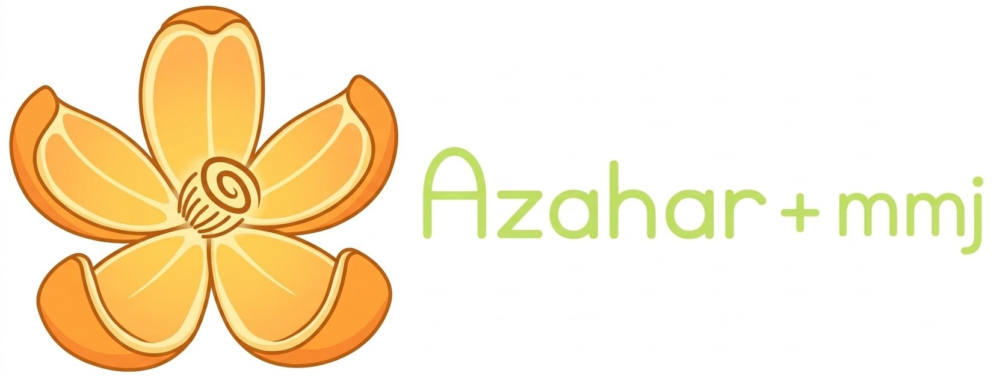

  

# Azahar+ mmj

**English** · [Español](README.es.md)

Azahar+ mmj is an unofficial Nintendo 3DS emulator for Android (the desktop sources are still in the tree). It is a fork of
[AzaharPlus](https://github.com/AzaharPlus/AzaharPlus), which is a fork of [Azahar](https://github.com/azahar-emu/azahar). The
fork exists to carry over the per-game fixes that [Citra MMJ](https://github.com/weihuoya/citra) collected over the years, and to
let you switch each one on or off from the settings.

It is not affiliated with, or endorsed by, Azahar, AzaharPlus, Citra, Lime3DS, the Citra MMJ authors or Nintendo.

- [Status](#status)
- [Why this fork exists](#why-this-fork-exists)
- [What it adds](#what-it-adds)
- [MMJ hacks](#mmj-hacks)
- [60 FPS cheats](#60-fps-cheats)
- [Installing and updating](#installing-and-updating)
- [Building](#building)
- [Where the data comes from](#where-the-data-comes-from)
- [Authorship and AI use](#authorship-and-ai-use)
- [Credits](#credits)
- [License](#license)
- [Reporting problems](#reporting-problems)

## Status

Experimental. The APK from the `azaharplus-mmj` branch builds on GitHub Actions and has been run on one device (POCO F7 Pro,
Snapdragon 8 Gen 3) with a handful of games. There are no per-hack A/B measurements and no game-by-game results yet; what has and
has not been checked is written down in [`docs/MMJ_PORT.md`](docs/MMJ_PORT.md). Several things below were only compiled, not
run, and are marked as such.

This repository has two lines of the same port:

| Branch | Based on | Notes |
|---|---|---|
| `azaharplus-mmj` | AzaharPlus (`cf90688`, 2026-10-08) | This one. Has the settings menu, update checker, 60 FPS cheat download. |
| `master` | Azahar | Older, no settings menu. |

GitHub only allows one fork of a given repository per account, which is why both live here as branches.

## Why this fork exists

Citra MMJ accumulated practical knowledge about specific 3DS games: which titles need accurate shader multiplication, which ones
run faster if a slow texture copy is skipped, which ones crash unless a draw is dropped. That knowledge is stored as lists of
title IDs. MMJ stopped merging upstream Citra changes in April 2020 and cannot be merged into current code, so the lists were at
risk of being lost with it.

This fork re-implements those hacks on top of Azahar's current `HackManager`, keeps the title ID lists, and documents what each
one does. Three rules apply to all of them:

- A hack only acts on the titles in its own list. Every other game runs as it does in AzaharPlus.
- Each hack has its own switch and can be turned off without affecting the others.
- Anything that has not been verified is labeled as unverified.

It is not meant to replace Azahar or AzaharPlus, and it is not offered to either project as a pull request (see
[Authorship and AI use](#authorship-and-ai-use)).

## What it adds

On top of what AzaharPlus already provides (game file compatibility with other Citra forks, system file download, ZipPass,
built-in cheats, amiibo generation and so on, as described in its own [README](docs/UPSTREAM_README.md); none of that has been
re-verified here):

| Feature | What it does | Why it is there |
|---|---|---|
| MMJ hack switches | One setting per hack under *Settings → Citra MMJ hacks*, with per-game overrides. Changes apply when a game starts. | So each fix can be tested and disabled on its own. |
| Experimental hacks | Five more hacks, off by default. Turning one on shows a dialog explaining why it was off. | They were not tested in this fork, so they should not run unless you ask for them. |
| 60 FPS cheat download | A section at the top of a game's cheat screen. The download button only appears when the game's title ID has a file in the cheat repository. | 60 FPS codes are per game. Offering them for the wrong title makes no sense. |
| Built-in cheat database fix | 198 cheats that shared a name but had different codes were silently dropped by the loader. They are now kept as `Name (2)`. | The database itself is valid; the loader was discarding data. |
| MMJ diagnostics | *Share MMJ diagnostics* in the home settings sends a short summary of the last log: header, active hacks and shader/pipeline stall measurements. | A full log is long and hard to read when someone reports a problem. |
| Stall measurement | OpenGL logs `Shader stall` and Vulkan logs `Pipeline stall` when a draw waits 4 ms or more on a shader or pipeline. | To measure shader-compile stutter before trying to fix it. |
| Per-game hack log line | Each game start logs `Per-game hacks for <title ID>: ...` with every hack's state. | Makes it easy to confirm which hacks were active. |
| Release-based updates | The app checks the Releases of this repository only, and a *Updates* entry in the home *Options* tab (the three dots) checks on demand. | The Azahar and AzaharPlus update notices were removed so this build never points users at another project. |
| Fork notice and credits | A dialog on first launch says this is an unofficial fork made with AI. *About → Credits and AI notice* lists everyone credited below. | Users should know what they are running and who to thank. |
| Resolution cap | Internal resolution is limited to 8x (Azahar allows up to 18x). | Carried over from the MMJ port. |
| Name and icon | Renamed to Azahar+ mmj with its own icon. About links point to this repository. | So it is not confused with upstream builds. |

## MMJ hacks

Menu path on Android: *Settings → Citra MMJ hacks* (Spanish: *Ajustes de Citra MMJ*). Switches in the first table are on by
default. Turning a switch off leaves those games exactly as AzaharPlus treats them without the port.

| Switch | Hack | Title IDs | Example games |
|---|---|---:|---|
| Accurate multiplication (MMJ list) | `ACCURATE_MULTIPLICATION_MMJ` | 42 | Super Mario 3D Land, Kid Icarus: Uprising, Majora's Mask 3D |
| Skip slow draws | `SKIP_SLOW_DRAW` | 4 | Dragon Quest Monsters: Joker 3, New Atelier Rorona |
| Skip texture copies | `SKIP_TEXTURE_COPY` | 19 | Mario Kart 7, Metroid Prime: Federation Force |
| Disable extra clip plane | `DISABLE_CLIP_COEF` | 9 | Star Fox 64, Picross 2 |
| Linear filter on magnification | `FORCE_LINEAR_MAG_FILTER` | 5 | Attack on Titan |
| Skip redundant YUV conversions | `SKIP_REDUNDANT_Y2R_CONVERSION` | 2 | Danball Senki |

The hacks live in code shared by the OpenGL and Vulkan renderers (and in the CPU and service layers), so they apply to both
backends. That is based on reading the code; it has not been checked game by game on each backend.

### Experimental hacks (off by default)

| Switch | Hack | Title IDs | Why it is off |
|---|---|---:|---|
| CPU usage limit | `CPU_USAGE_LIMIT`, `CPU_USAGE_LIMIT_HEAVY` | 31 | MMJ built it on its own CPU scheduler. Azahar splits time between cores differently, so the effect here is unknown. |
| Skip invalidation on CPU writes | `SKIP_CPU_WRITE` | 3 (Lord of Magna) | Written for MMJ's texture cache, which Azahar later rewrote. It can leave stale graphics on screen. |
| Display transfer address remap | `DISPLAY_TRANSFER_REMAP` | 4 (Tales of the Abyss, Pac-Man Party 3D) | Fixed addresses copied from MMJ and never checked against these games. It was added next to a crash workaround that Azahar has since fixed. |
| Minimum CPU ticks per flush ("FMV hack") | `FMV_TICKS` | 10 (Mirror of Fate, Luigi's Mansion: Dark Moon, Zombie Panic in Wonderland DX) | MMJ does not document what it fixes. AzaharPlus has three CPU backends that count ticks differently. Dynarmic, DynCom and FastInterp are all covered, none of them tested. |
| Disable shadow rendering | `DISABLE_SHADOW_RENDERING` | 4 (Luigi's Mansion: Dark Moon) | The code that reads this list is not in MMJ's public source. The implementation copies what MMJ does on GPUs without shadow support, which is to skip the shadow draws. |

Hacks that were not ported, and the reason for each (for example `stream_buffer_hack`, which Azahar already handles the way those
games need), are in [`docs/MMJ_PORT.md`](docs/MMJ_PORT.md).

## 60 FPS cheats

Open the cheats screen of a game. At the top there is a 60 FPS section that always shows the game's title ID. The
download button appears only if that ID has a file in
[Reshiban/60FPS-AR-CHEATS-3DS](https://github.com/Reshiban/60FPS-AR-CHEATS-3DS) (241 IDs in the bundled index). For any other
game the section only shows the ID.

- The app does not bundle or redistribute those cheats. It ships an index of title IDs and folder names and downloads the game's
  file from GitHub, pinned to commit
  [`041cfa0`](https://github.com/Reshiban/60FPS-AR-CHEATS-3DS/commit/041cfa08a864565e3026896a2f3287579e6b9195). That repository
  declares no license, so none of its files are copied here.
- The CTRPF format (folders, `{...}` comments) is converted to regular Gateway/AR cheats. Folder names become a prefix on the
  cheat name.
- Cheats are added switched off and existing cheats are not touched. Cheats that use opcodes the emulator does not implement are
  skipped (4 of 1330 at the pinned commit).
- These are third-party codes written for real consoles and have not been verified here. Some, such as the Pokémon ones, make the
  game run faster.

## Installing and updating

Every successful build on GitHub Actions publishes a release named `build-<n>`, marked as pre-release, with the APK attached.
The 10 most recent are kept. Download the APK from the
[Releases page](https://github.com/axelconde7w7-gif/azaharplus-mmj/releases) and install it.

The APK uses the `.mmj` suffix in its application ID, so it installs next to Azahar or AzaharPlus rather than replacing them.

Inside the app:

- On launch it checks this repository's Releases and offers the download if there is a newer build. This can be turned off in
  *Settings → General → Check for updates*.
- *Updates* at the top of the home *Options* tab shows the installed build number and checks immediately, even when the automatic
  check is off.
- Local builds (build number 0) never check for updates.
- Nothing is installed automatically. Android asks for confirmation each time.

To install a new build over the old one, the APK has to be signed with the same key every time. Without one, CI signs with a
temporary debug key, the signature changes on every build and Android refuses the update, so you would have to uninstall first.
To fix a key, create a keystore and add these repository secrets under *Settings → Secrets and variables → Actions*:

- `ANDROID_KEYSTORE_BASE64`: the `.jks` file encoded in base64
- `ANDROID_KEYSTORE_PASS`: the keystore password (it is also used as the key password)
- `ANDROID_KEY_ALIAS`: the key alias

Keep a safe copy of the keystore. If it is lost, nobody can update over existing installs.

## Building

Full instructions (Android Studio, GitHub Actions, what to look at in each game) are in
[`docs/ANDROID_TEST.md`](docs/ANDROID_TEST.md), currently in Spanish. In short: open `src/android` in Android Studio, or let the
workflow in `.github/workflows/android-apk.yml` build an arm64 APK. To check that a build is this fork: internal resolution
stops at 8x, the Citra MMJ menu exists and each game's log has a `Per-game hacks for <ID>` line.

## Where the data comes from

GitHub allows a single parent per fork (here, AzaharPlus), so the link to MMJ is kept as permanent links to the original
commits.

| Data | First MMJ commit where it appears | Author | Date |
|---|---|---|---|
| `skip_slow_draw` | [`e85a43c`](https://github.com/weihuoya/citra/commit/e85a43cf92e446b4ac4af99a22b53655ea12b92e) | weihuoya | 2020-07-06 |
| `disable_clip_coef` | [`0467d74`](https://github.com/weihuoya/citra/commit/0467d74465a73aba30b8ab712243f9f14b7bcb2d) | weihuoya | 2020-09-21 |
| `y2r_perform_hack` | [`965594b`](https://github.com/weihuoya/citra/commit/965594b140bf6c5c3f5caf6a674d5d3a8a44f5a7) | weihuoya | 2020-12-25 |
| `use_linear_filter` | [`21c231f`](https://github.com/weihuoya/citra/commit/21c231fbc2e1d1523a250330b2543b3c96c0875f) | weihuoya | 2021-01-18 |
| `skip_texture_copy` | [`3c93fb4`](https://github.com/weihuoya/citra/commit/3c93fb489497dd49b58afa5187e735609b149a53) | weihuoya | 2022-01-20 |
| Full ID lists (`config-games.ini`) | created in [`79564b5`](https://github.com/weihuoya/citra/commit/79564b5f34fec812c6750b7165099023f83086a7); [version used here](https://github.com/weihuoya/citra/blob/302b0c3bc4312bc96489c11584a97664894b343f/src/android/app/src/main/assets/config/config-games.ini) | weihuoya / zhangwei | 2022-04-19 / 2025-11-14 |

MMJ commit messages are very short (`fx`, `cache`), so a commit can bundle other changes. The table shows where the setting's name
first appears. To browse the full history locally: `git remote add mmj https://github.com/weihuoya/citra.git`.

## Authorship and AI use

The code and documentation for this fork's changes were written with Claude (Anthropic), following the direction and decisions of
the repository owner. Commits carry a `Co-Authored-By` trailer, and the app says so at first launch and under *About → Credits and
AI notice*.

Two practical consequences:

- Azahar has an [AI policy](https://github.com/azahar-emu/azahar/blob/master/AI-POLICY.md) that forbids submitting code written
  wholly or substantially by AI. For that reason this fork is not proposed as a pull request to Azahar or AzaharPlus, and nobody
  should do so on its behalf.
- AI-written code can be wrong. Read the diff before trusting it, particularly anything under `video_core`.

## Credits

Most of what is useful here is other people's work.

- [Azahar Emulator Project](https://github.com/azahar-emu/azahar) and its developers: the base of everything, including the
  `HackManager` that makes per-title behavior possible.
- [AzaharPlus](https://github.com/AzaharPlus/AzaharPlus) and its team (their page does not name the individuals): the direct base
  of this fork, its extra features and the built-in cheat database.
- Citra Emulator Project and its contributors, who made the emulator Azahar, Lime3DS and Citra MMJ descend from.
- Lime3DS and its contributors. Azahar continues from it.
- [weihuoya](https://github.com/weihuoya/citra), author of Citra MMJ between 2019 and 2022 (94 commits of their own since April
  2020). The hacks, title IDs and per-game observations adapted here come from their work and their testing with real games.
- zhangwei, who maintained Citra MMJ from 2023 to 2025 (23 commits, including the last). Their version of `config-games.ini` is
  the data source used here.
- [Reshiban](https://github.com/Reshiban/60FPS-AR-CHEATS-3DS) and the authors of the 60 FPS cheats the app downloads from that
  repository: Hazerou (GBAtemp thread), lucky, NanashiFinal13, Spooky and others named in each cheat. They are downloaded on
  demand, not redistributed.
- The authors of the bundled libraries (Dynarmic, libzip and others), under their own licenses.
- Claude (Anthropic) wrote the code and documentation of this fork's changes, and
  [axelconde7w7-gif](https://github.com/axelconde7w7-gif) directs the project, decides what gets done and tests it on a device.
- Logo: the flower is Azahar's logo, property of PabloMK7 and angyartanddraw (see
  `the_azahar_logo_is_the_property_of_PabloMK7_and_angyartanddraw.txt`). It is used here to identify the base of the project and
  does not imply official endorsement.

If you wrote any of these projects and want something corrected or removed, open an issue here.

## License

Azahar, AzaharPlus, Citra and Citra MMJ are distributed under GPL licenses. Every file keeps its original copyright notice and
license (mostly GPLv2 or later, some newer files GPLv3 or later). See the file headers, [`LICENSE.txt`](LICENSE.txt) and
[`misc/licenses/`](misc/licenses/). Changes in this fork are published under the same terms.

## Reporting problems

Problems with this fork (a hack that breaks a game, a build failure) go in an issue in this repository. Include the game, its title
ID, the phone and, if possible, the *Share MMJ diagnostics* output or the log. Please do not report problems seen with this fork
to the Azahar or AzaharPlus repositories.

This project is an emulator and does not include games, keys or Nintendo firmware, and does not help obtain them. Use it only
with copies of games you legally obtained from your own console. Nintendo and Nintendo 3DS are trademarks of Nintendo.
